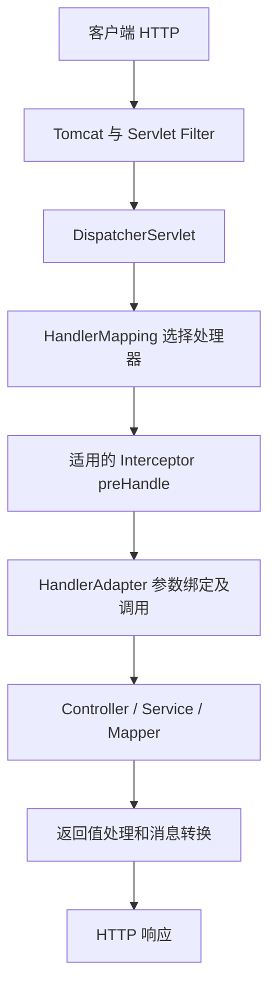

# 从 HTTP 到 Controller：MVC 请求链

> 课程基线：Java 17＋／Spring Boot 3.x（涉及 Spring 时采用 6.x、Jakarta 命名空间）。代码中标注的业务片段需要应用依赖与上下文，不等同于完整生产系统。

## 两种分层不要混淆

Tomcat 是 Servlet 容器，DispatcherServlet 本身是 Servlet；Spring MVC 在其上协调 Web 请求。Controller→Service→Mapper 是项目常见职责分层，不是 Spring MVC 强制的三层组成。Mapper 通常经 MyBatis、JDBC 和驱动访问数据库。



这是同步 Servlet 请求逻辑图，省略异常与异步分支，不是所有类严格各执行一次的源码追踪。

## 实际开发：订单查询

```java
@RestController
@RequestMapping("/api/orders")
class OrderController {
    @GetMapping("/{id}")
    String detail(@PathVariable("id") Long id,
                  @RequestParam(defaultValue = "false") boolean brief) {
        return "订单：" + id + "，简要：" + brief;
    }
}
```

@PathVariable 取路径；@RequestParam 取查询或表单参数；@RequestHeader 取头；@RequestBody 经 HttpMessageConverter 读请求体，JSON 常由 Jackson 处理。@PostMapping 只限定 HTTP 方法，不等于“必须 JSON”或“自动入库”。

## HTTP 语义与 JSON

GET 应按安全读取语义设计，POST 提交处理，PUT 对指定资源整体替换，PATCH 部分修改，DELETE 删除。幂等关注重复请求对目标状态的预期影响，不保证每次响应码相同。创建通常返回 201，成功无正文可返回 204，认证失败与授权失败分别考虑 401、403。

@RestController 的对象通常经合适转换器输出 JSON，String 也可能直接按文本输出，并不是所有返回值都自动 JSON。JSON 文本不是跨进程直接传 Java 对象；反序列化是否忽略未知字段受 ObjectMapper 配置影响。Java Long 超过前端安全整数范围时，API 需要明确字符串化等约定。

## 错误定位

404 先核对完整路径与 context path；405 核对方法；415 核对 Content-Type 和支持的转换器；400 再区分 JSON 无法解析、类型转换失败与约束不满足。先看实际 HTTP 状态与日志，不靠“前端弹窗失败”猜原因。

## 参考资料

- [Spring 6.2 DispatcherServlet](https://docs.spring.io/spring-framework/reference/6.2/web/webmvc/mvc-servlet.html)
- [映射请求](https://docs.spring.io/spring-framework/reference/6.2/web/webmvc/mvc-controller/ann-requestmapping.html)
- [RFC 9110：HTTP 语义](https://www.rfc-editor.org/rfc/rfc9110.html)

## 模拟面试问题

1. 【基础】Tomcat 是否直接查找 @GetMapping 方法？
2. 【应用】POST 收到 415 与 400 分别应从哪里查起？
3. 【应用】Controller 返回 Java 对象后如何形成 JSON？
4. 【深入】DELETE 第二次返回 404 为什么仍可符合幂等语义？
5. 【深入】为什么三层架构不是 Spring MVC 的定义？

