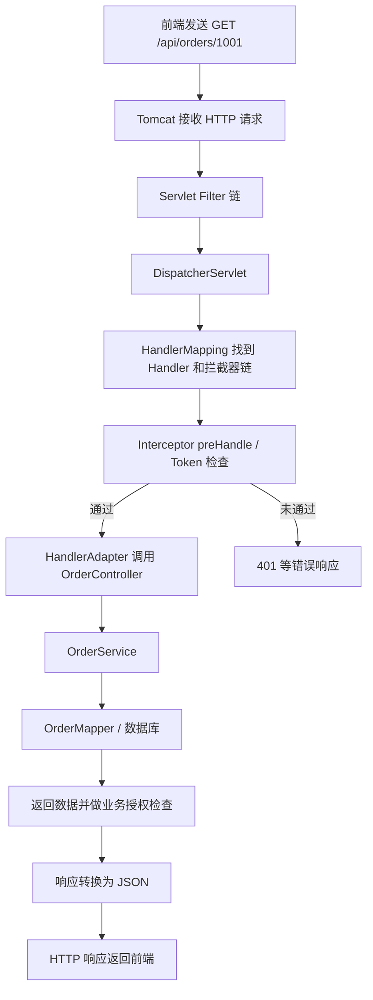

# Java 后端五大基础：反射、HTTP、Spring IoC/DI、Spring MVC、JWT

> **校订版学习笔记**｜2026-10-23  
> 适用对象：正在学习 Spring Boot、准备 Java 后端实习与技术面试的开发者。  
> 依据：本次聊天中的五部分讲解；针对容易产生误解的地方，参考 Spring、JJWT 官方文档及 HTTP/JWT RFC 补充核对。  
> 代码范围：以 **Java 17+ / Spring Boot 3.x（Jakarta Servlet）/ JJWT 0.12.x** 的常见写法为参考。代码分段用于解释原理，**并非完整可直接运行的项目**。

## 目录

1. [先看正确性审查](#1-先看正确性审查)
2. [五大知识模块如何串起来](#2-五大知识模块如何串起来)
3. [Java 反射](#3-java-反射)
4. [HTTP 协议](#4-http-协议)
5. [Spring IoC 与 DI](#5-spring-ioc-与-di)
6. [Spring MVC](#6-spring-mvc)
7. [JWT 与登录鉴权](#7-jwt-与登录鉴权)
8. [综合实战：获取自己的订单](#8-综合实战获取自己的订单)
9. [容易混淆的概念对照表](#9-容易混淆的概念对照表)
10. [面试自测与学习路线](#10-面试自测与学习路线)
11. [官方参考资料](#11-官方参考资料)

---

## 1. 先看正确性审查

**总体判断：原聊天的核心概念和主线正确，可以作为学习基础；但部分例子属于简化模型，不能误认为是完整源码或生产级实现。**

| 原聊天主题 | 核对结论 | 应补充或修正的内容 |
| --- | --- | --- |
| 反射：Spring 动态创建对象 | 基本正确 | 反射是实现手段之一；`for (Class<?> ...)` 只是教学伪代码。实际经过 BeanDefinition、依赖解析、生命周期处理等机制。 |
| HTTP 请求与响应、状态码 | 正确 | 幂等性描述的是“预期服务器效果”，不是多次请求状态码完全一样；401/403 的语义要分清。 |
| IoC / DI、`@Component` / `@Bean` | 正确 | 能否扫描到组件取决于扫描范围；`@Bean` 由被容器处理的配置机制注册，并非写在任意普通类里都有效。 |
| 构造器注入 | 正确 | 单构造器的 Spring Bean 通常不需要显式 `@Autowired`；有多个同类型候选 Bean 时可能需要 `@Qualifier` 等限定。 |
| Bean 生命周期与 AOP | 基本正确 | `@PostConstruct` 通常由初始化前的 BeanPostProcessor 触发；AOP 代理常在后置处理阶段产生，但不能当作所有 Bean 的固定规律。 |
| Spring MVC 链路 | 正确（简化） | `HandlerMapping` 选处理器，`HandlerAdapter` 帮助调用；Controller 参数绑定、异常解析、返回值转换均会参与。 |
| `HandlerInterceptor` | 正确 | 对 `@ResponseBody` / `ResponseEntity`，响应可能在 `postHandle` 前已写入；`postHandle` 不适合统一修改 JSON。 |
| 拦截器做 JWT 安全防护 | **教学可行，工程上需修正** | Spring 官方不建议仅把 MVC Interceptor 作为完整安全层；正式系统通常使用 Spring Security/Servlet Filter 安全链。 |
| JWT 签名、有效期 | 正确 | 一般的三段式签名 JWT（JWS）不等于加密；验签成功不代表有访问某条业务数据的权限。 |
| JWT 工具类 | 核心 API 正确（JJWT 0.12.x） | 不应把**所有**异常都吞掉当成 401；需配置签发方/接收方校验、密钥管理，必要时还需撤销机制。 |
| 订单查询项目示例 | 业务流程正确 | `GET /orders/{id}` 必须验证该订单属于当前登录用户，避免越权（IDOR / BOLA）。原代码缺少此检查。 |

### 三项最重要的纠偏

1. **身份认证 ≠ 访问授权**：Token 有效只能证明令牌符合设定的认证条件，不能自动证明请求人有权读取其他用户的订单。
2. **MVC 拦截器 ≠ 完整安全体系**：自己写 `preHandle` 很适合学习和简单演示，但真实项目应优先理解 Spring Security FilterChain。
3. **Bean 创建 ≠ 简单反射 `newInstance`**：需要把“类发现 → Bean 定义 → 实例化 → 注入 → 初始化 → 可能的代理 → 使用”作为一套流程来理解。

---

## 2. 五大知识模块如何串起来

假设用户点击“查询订单”：



- **HTTP**：规定请求和响应如何表达。
- **Spring MVC**：找到并调用对应的 Web 处理器。
- **JWT**：承载带签名的身份声明；是否被接受取决于验证规则。
- **IoC / DI**：创建和装配 Controller、Service 等对象；它们通常不是每次请求重新创建的。
- **Java 反射**：被框架用于运行时类信息访问、实例化或方法调用等场景，**不是每次请求都“反射创建一遍 Controller”**。

---

## 3. Java 反射

### 3.1 核心概念

Java 反射（Reflection）允许程序在**运行时**获取类、构造器、方法、字段的信息，并动态执行某些操作。

四个重要类型：

| 类型 | 功能 |
| --- | --- |
| `Class<?>` | 表示类的运行时信息 |
| `Constructor<?>` | 获取、调用构造器 |
| `Method` | 获取、调用方法 |
| `Field` | 获取、读写字段（访问仍受规则限制） |

### 3.2 常用代码

```java
public class User {
    private String name;

    public User() {}

    public void sayHello() {
        System.out.println("Hello");
    }
}
```

```java
import java.lang.reflect.Constructor;
import java.lang.reflect.Method;

public class ReflectionDemo {
    public static void main(String[] args) throws Exception {
        // 三种获取 Class 的典型方式：
        Class<User> c1 = User.class;
        Class<?> c2 = new User().getClass();
        Class<?> c3 = Class.forName("com.example.User"); // 需匹配实际包名

        Constructor<?> constructor = c3.getDeclaredConstructor();
        Object obj = constructor.newInstance();

        Method method = c3.getMethod("sayHello");
        method.invoke(obj); // 输出 Hello
    }
}
```

关键理解：

- `Class.forName("完整限定名")`：按名称获取类；其行为还可能涉及类加载与初始化。
- `getDeclaredConstructor()`：获取本类声明的指定构造器；是否可访问要另行考虑。
- `newInstance()`：通过构造器创建实例；抽象类、接口等无法直接实例化。
- `Method.invoke(obj, ...)`：反射调用方法。

> **注意**：上面两个代码块只是演示结构；运行时必须保证 `User` 的实际包名与 `Class.forName` 一致，并处理可能的反射异常。

### 3.3 与 Spring 的关系

Spring 可以先扫描/注册 BeanDefinition，再按构造器等规则创建对象并注入依赖。实现过程中可能用反射；但也可以涉及工厂方法、代理、缓存、扩展处理器等。

**不要把以下伪代码误认成 Spring 真正的创建过程：**

```java
if (clazz.isAnnotationPresent(Component.class)) {
    Object bean = clazz.getDeclaredConstructor().newInstance();
    container.put(clazz, bean);
}
```

真实场景中，**注册元数据**与**创建最终 Bean 对象**是两个不同层次。

### 3.4 面试答法

> 反射是 Java 在运行时访问类结构并动态调用构造器、方法、字段的机制。Spring 可以利用反射进行对象实例化和依赖装配，但 Spring 容器还包含 BeanDefinition、作用域、生命周期、后置处理器和代理等机制。

---

## 4. HTTP 协议

### 4.1 一个请求长什么样

```http
POST /api/orders HTTP/1.1
Host: localhost:8080
Content-Type: application/json
Authorization: Bearer <access-token>

{
  "dishId": 1001,
  "quantity": 2
}
```

对于 HTTP/1.1，这里可分为：

- **请求行**：方法、目标、版本。
- **请求头**：内容类型、认证凭证等。
- **请求体**：具体业务数据（并非所有请求都有）。

### 4.2 常见方法及性质

| 方法 | 通常用途 | HTTP 语义上的安全性 | HTTP 语义上的幂等性 |
| --- | --- | --- | --- |
| GET | 读取资源 | 是 | 是 |
| POST | 提交或创建资源 | 否 | 不保证 |
| PUT | 替换目标资源状态 | 否 | 是 |
| PATCH | 部分修改 | 否 | 不保证 |
| DELETE | 删除资源 | 否 | 是 |

**安全**：客户端按方法语义不要求改变资源状态。  
**幂等**：对目标资源，多次执行相同请求的**预期效果**与执行一次一致。

示例：第一次 DELETE 返回 `204`，第二次返回 `404`，不妨碍 DELETE 在方法语义上具备幂等性。

### 4.3 HTTP 响应

```http
HTTP/1.1 200 OK
Content-Type: application/json

{
  "code": 200,
  "message": "success",
  "data": { "orderId": 10086 }
}
```

| HTTP 状态码 | 重点含义 |
| --- | --- |
| 200 | 成功 |
| 201 | 创建资源成功 |
| 204 | 成功但无响应体 |
| 400 | 错误请求 |
| 401 | 缺少有效身份认证凭证 |
| 403 | 拒绝访问、没有相应权限 |
| 404 | 未找到目标资源 |
| 405 | 目标资源不允许该方法 |
| 500 | 服务器内部错误 |
| 502 | 网关收到无效上游响应 |
| 503 | 服务不可用 |

**重点**：HTTP 的 `401` 不应直接理解成“权限不足”；权限问题常见返回 `403`。实际状态码还取决于认证方案和安全设计。

### 4.4 Spring MVC 的参数绑定

```java
@RestController
@RequestMapping("/orders")
public class OrderController {

    @GetMapping("/{id}")
    public String detail(@PathVariable Long id) {
        return "订单ID：" + id;
    }

    @PostMapping
    public String create(@RequestBody CreateOrderRequest request) {
        return "收到数量：" + request.quantity();
    }
}

record CreateOrderRequest(Long dishId, Integer quantity) {}
```

- `@PathVariable`：路径变量，如 `/orders/1001` 的 `1001`。
- `@RequestParam`：查询参数，如 `/orders?page=1`。
- `@RequestBody`：通常将 JSON 请求体反序列化为 Java 对象。
- `@RequestHeader`：读取 HTTP 请求头。

> `@RequestBody` 不是自动完成所有验证；字段必填、数值范围等常需结合 Bean Validation 等机制。

---

## 5. Spring IoC 与 DI

### 5.1 IoC：控制反转

**IoC（Inversion of Control）**：对象的创建、获取、依赖关联与管理不再完全由业务类自行负责，而由容器控制。

传统写法（示意）：

```java
public class OrderService {
    private final StockService stockService = new StockService();
}
```

Spring 管理后的写法：

```java
@Service
public class OrderService {
    private final StockService stockService;

    public OrderService(StockService stockService) {
        this.stockService = stockService;
    }
}
```

这里的 `StockService` 也要能够被容器提供。

### 5.2 DI：依赖注入

**DI（Dependency Injection）**：由外部（此处是 Spring 容器）为目标对象提供所需依赖。DI 是实现 IoC 思想的一种重要方式。

三种常见注入方式：

1. **构造器注入（推荐用于必需依赖）**：对象创建时提供依赖，可以使用 `final`。
2. Setter 注入：适合部分可选、可重新配置的依赖场景。
3. 字段注入：写法简单，但隐藏依赖、不利于普通单元测试。

**单个构造器**时，Spring 通常可以自动选择它，不必写 `@Autowired`。若候选依赖不唯一，可通过 `@Qualifier`、`@Primary` 等消歧。

### 5.3 什么是 Bean？

**Bean 是由 Spring IoC 容器管理的对象。**

```java
@Service
public class StockService {}
```

当它处于被扫描、注册并由容器管理的范围内，Spring 能为它提供 Bean。

```java
StockService local = new StockService();
```

这个 `local` 仅仅是普通 Java 对象，**不会因为类上有 `@Service` 就自动变成容器管理的对象**。

### 5.4 如何注册 Bean？

**组件扫描：**

```java
@Component   // 通用组件
@Service     // 业务层
@Repository  // 数据访问层
@Controller  // Web 控制层
```

`@RestController` 组合了 `@Controller` 与 `@ResponseBody` 的语义。

**配置方法：**

```java
@Configuration
public class AppConfig {
    @Bean
    public MyClient myClient() {
        return new MyClient();
    }
}
```

- `@Component` 系列：通常加在类上，交给组件扫描发现。
- `@Bean`：加在受 Spring 配置机制处理的方法上，以返回对象注册 Bean。
- 第三方类无法修改源码时，常用 `@Bean`。

**重要补充：组件扫描范围**

```text
com.example.demo
├── DemoApplication.java   // @SpringBootApplication
├── controller/
├── service/
└── config/
```

默认情况下，`@SpringBootApplication` 的组件扫描通常从**启动类所在包及其子包**开始。放在其外面的组件可能扫描不到，需要调整项目结构或显式配置扫描范围。

### 5.5 Spring 容器

- `BeanFactory`：基础 Bean 管理容器接口。
- `ApplicationContext`：在 BeanFactory 能力基础上提供更多应用级功能，例如事件、资源、国际化等。

```java
ConfigurableApplicationContext context =
        SpringApplication.run(DemoApplication.class, args);

OrderService service = context.getBean(OrderService.class);
```

日常开发优先使用依赖注入，不推荐业务代码四处手动 `getBean()`。

### 5.6 Bean 作用域

| Scope | 含义 |
| --- | --- |
| `singleton` | 一个容器中一个 Bean 定义通常共享一个实例；默认作用域 |
| `prototype` | 每次向容器获取通常创建新实例 |
| `request` | Web 环境中每个 HTTP 请求一个实例 |
| `session` | Web 环境中每个 HTTP Session 一个实例 |

要点：

- 默认 `singleton` 不代表线程安全。
- 普通非懒加载单例 Bean 通常在容器启动阶段初始化。
- 把 prototype 注入 singleton 后，不意味着 singleton 每次使用时都会自动拿到新的 prototype 对象。

### 5.7 Bean 生命周期（学习简图）

```text
读取配置/扫描并注册 BeanDefinition
            ↓
实例化对象（构造器或工厂方法等）
            ↓
依赖注入、属性填充、Aware 回调等
            ↓
BeanPostProcessor 初始化前处理
   └─ @PostConstruct 通常在此阶段触发
            ↓
InitializingBean / 自定义 init 方法
            ↓
BeanPostProcessor 初始化后处理
   └─ 某些 AOP 代理可能在此生成
            ↓
Bean 对外提供服务
            ↓
容器结束时调用适用的销毁回调
```

这是抽象流程，不代表每个 Bean 都执行全部步骤，也不代表所有代理一定产生于固定步骤。

### 5.8 与 AOP 的区别

- **IoC**：管理对象和依赖。
- **DI**：将依赖提供给对象。
- **AOP**：分离事务、日志等横切关注点，通常借助代理实现。

Spring AOP 常见应用：`@Transactional` 事务、切面日志等。对同类内部调用、代理生效范围等还需进一步学习。

---

## 6. Spring MVC

### 6.1 是什么？

Spring MVC 基于 Servlet Web 技术栈，通过 `DispatcherServlet` 协调 Web 请求：匹配 Controller、绑定参数、调用方法、处理异常、转换返回值。

### 6.2 请求处理主链路

```text
客户端
  ↓ HTTP
Tomcat
  ↓
Servlet Filter 链
  ↓
DispatcherServlet
  ↓
HandlerMapping → 定位 Controller 方法和拦截器链
  ↓
HandlerInterceptor.preHandle()
  ↓ (true 才继续)
HandlerAdapter → 参数绑定并调用 Controller
  ↓
Controller → Service → DAO/Mapper
  ↓
返回值处理 / JSON 序列化 / 异常解析等
  ↓
HTTP 响应
```

注意：这是逻辑示意，不是所有组件按图中顺序逐个执行一次的精确源码追踪。JSON 写出与拦截器回调的时序需要单独关注。

### 6.3 `HandlerInterceptor` 的三个回调

| 方法 | 时机 | 常见用途 |
| --- | --- | --- |
| `preHandle` | Controller 执行之前 | 鉴权预检查、审计开始 |
| `postHandle` | Handler 正常执行之后 | 传统 MVC 的 ModelAndView 相关处理 |
| `afterCompletion` | MVC 请求处理完成后的回调 | 清理资源、审计结束 |

```java
@Component
public class LogInterceptor implements HandlerInterceptor {
    @Override
    public boolean preHandle(
            HttpServletRequest request,
            HttpServletResponse response,
            Object handler) {
        System.out.println("开始处理: " + request.getRequestURI());
        return true;
    }

    @Override
    public void afterCompletion(
            HttpServletRequest request,
            HttpServletResponse response,
            Object handler,
            Exception ex) {
        System.out.println("处理结束");
    }
}
```

这里的 `HttpServletRequest` / `HttpServletResponse` 使用 **`jakarta.servlet.http`**（Spring Boot 3.x）。

- `preHandle` 返回 `false`：不会继续执行当前 Handler。
- `afterCompletion` 只会按契约对已经成功通过 `preHandle` 的相应拦截器回调；异常和多个拦截器时需要特别注意顺序。
- `@ResponseBody` / `ResponseEntity` 的响应体通常在 `HandlerAdapter` 内写出，**不要靠 `postHandle` 统一修改 JSON**。可学习 `ResponseBodyAdvice` 等机制。

### 6.4 `WebMvcConfigurer` 负责什么？

这个接口用来扩展 Spring MVC 配置，例如：拦截器、跨域、格式转换、资源映射、参数解析器等。

```java
@Configuration
public class WebConfig implements WebMvcConfigurer {
    private final LogInterceptor logInterceptor;

    public WebConfig(LogInterceptor logInterceptor) {
        this.logInterceptor = logInterceptor;
    }

    @Override
    public void addInterceptors(InterceptorRegistry registry) {
        registry.addInterceptor(logInterceptor)
                .addPathPatterns("/api/**")
                .excludePathPatterns("/api/auth/login");
    }
}
```

**记忆口诀：**

- `HandlerInterceptor`：写**拦截时做什么**。
- `WebMvcConfigurer`：配置**在哪些 MVC 请求上生效**。

### 6.5 Filter 与 Interceptor

| 项目 | Servlet Filter | Spring MVC Interceptor |
| --- | --- | --- |
| 所属层 | Servlet 容器链 | Spring MVC Handler 链 |
| 进入时机 | 通常早于 `DispatcherServlet` | 定位 Handler 之后、实际调用 Handler 之前 |
| 是否天然了解 Controller 处理器 | 一般不了解 | 可获得 `handler` 信息 |
| 常见功能 | 安全过滤链、通用请求处理 | MVC 层日志、预处理与业务拦截 |

**安全提醒**：Spring 官方明确指出 MVC Interceptor 并不是理想的完整安全层，因为其匹配逻辑可能与 Controller 路由产生偏差。正式项目优先学习 **Spring Security / SecurityFilterChain**。

---

## 7. JWT 与登录鉴权

### 7.1 JWT 是什么？

JWT（JSON Web Token）是一种以 JSON 承载声明的令牌格式。常见的三段式签名令牌实际上是 JWT 作为 **JWS** 使用：

```text
Base64URL(Header).Base64URL(Payload).Signature
```

**JWT ≠ Bearer ≠ Spring Security**：

- JWT：令牌格式。
- Bearer：持有凭证即可尝试访问的一种使用方式，常在 Authorization 头传递。
- Spring Security：Java 生态安全框架。

### 7.2 三段结构

**Header（示例）：**

```json
{"alg":"HS256","typ":"JWT"}
```

**Payload（示例）：**

```json
{"sub":"10001","iss":"demo-api","iat":1792000000,"exp":1792007200}
```

**Signature：** 对 Header 和 Payload 的编码内容按指定签名算法进行完整性保护。

| Claim | 意思 |
| --- | --- |
| `sub` | 令牌主体，常为用户 ID |
| `iss` | 签发方 |
| `aud` | 预期接收方 |
| `iat` | 签发时间 |
| `nbf` | 开始生效时间 |
| `exp` | 过期时间 |
| `jti` | 令牌唯一 ID |

时间类型 NumericDate 通常以 Unix 时间戳的**秒**计。

**不要误会：**普通签名 JWS 的 Payload 只是编码，通常能直接解码；**不能把用户密码、密钥、敏感隐私直接装进去**。

### 7.3 签名验证的原理

HS256 示例（概念表达）：

```text
Signature = HMAC-SHA256(
    secret,
    Base64URL(Header) + "." + Base64URL(Payload)
)
```

验证者用可信密钥验证签名。不持有密钥的人即使修改 `sub` 也无法正常生成有效签名。

但**签名有效 ≠ Token 还能使用 ≠ 用户有业务权限**：

1. 签名必须合法。
2. `exp`、`nbf` 等有效期条件必须满足。
3. 按系统需要检查 `iss`、`aud`、算法、Token 类型等。
4. 令牌可能已被撤销，账户可能被禁用。
5. 对具体资源还要额外做**授权**。

### 7.4 Session 与 JWT

| 方案 | 客户端通常携带 | 服务端通常要做什么 |
| --- | --- | --- |
| Session | Session ID（常存于 Cookie） | 找到对应服务端会话状态 |
| 自包含 JWT | Token（常放在 Authorization 头） | 验签并检查声明，可不依赖集中式会话查询 |

JWT 常可减少对集中式会话数据的依赖，但也增加了登出、撤销及泄露后的风险处置复杂度。不能笼统认为 JWT 一定优于 Session。

### 7.5 JJWT 0.12.x：签发与校验（校订版）

**依赖提示**：通常需要匹配版本的 `jjwt-api`、`jjwt-impl`，以及一种 JSON 实现（如 `jjwt-jackson`）。这里不锁定具体补丁版本；必须保证各 JJWT 模块版本一致。

```yaml
# application.yml，仅为读取密钥的配置示例
jwt:
  secret-base64: ${JWT_SECRET_BASE64}
```

环境变量 `JWT_SECRET_BASE64` 应存放**强随机密钥的 Base64 编码**。HS256 至少需要 **32 字节（256 位）**密钥材料；不要把生产密钥写入 Git 仓库。

```java
import io.jsonwebtoken.Claims;
import io.jsonwebtoken.Jwts;
import io.jsonwebtoken.io.Decoders;
import io.jsonwebtoken.security.Keys;
import org.springframework.beans.factory.annotation.Value;
import org.springframework.stereotype.Component;
import javax.crypto.SecretKey;
import java.util.Date;

@Component
public class JwtUtil {
    private final SecretKey key;

    public JwtUtil(@Value("${jwt.secret-base64}") String base64Secret) {
        byte[] bytes = Decoders.BASE64.decode(base64Secret);
        this.key = Keys.hmacShaKeyFor(bytes);
    }

    public String generateToken(Long userId) {
        Date now = new Date();
        Date expire = new Date(now.getTime() + 2 * 60 * 60 * 1000L);
        return Jwts.builder()
                .issuer("demo-api")
                .subject(userId.toString())
                .issuedAt(now)
                .expiration(expire)
                .signWith(key, Jwts.SIG.HS256)
                .compact();
    }

    public Long verifyAndGetUserId(String token) {
        Claims claims = Jwts.parser()
                .verifyWith(key)
                .requireIssuer("demo-api")
                .build()
                .parseSignedClaims(token)
                .getPayload();
        return Long.valueOf(claims.getSubject());
    }
}
```

说明：

- `signWith`：指定签名密钥与算法。
- `verifyWith` + `parseSignedClaims`：验签并解析签名 JWT。
- `requireIssuer("demo-api")`：在示例中要求令牌具有预期签发方。
- `exp` / `nbf`（若存在）等时间声明会由库进行相关验证；需要配置的额外业务声明不能只靠“能解析成功”来代替。
- `sub` 这里约定为能够解析为 Long 的用户 ID。若令牌来自不可信来源，还要处理缺失/格式异常。

### 7.6 用 Interceptor 演示 JWT 检查

```java
import io.jsonwebtoken.JwtException;
import jakarta.servlet.http.HttpServletRequest;
import jakarta.servlet.http.HttpServletResponse;
import org.springframework.stereotype.Component;
import org.springframework.web.servlet.HandlerInterceptor;
import java.io.IOException;

@Component
public class JwtInterceptor implements HandlerInterceptor {
    private final JwtUtil jwtUtil;

    public JwtInterceptor(JwtUtil jwtUtil) {
        this.jwtUtil = jwtUtil;
    }

    @Override
    public boolean preHandle(HttpServletRequest request,
                             HttpServletResponse response,
                             Object handler) throws IOException {
        String authorization = request.getHeader("Authorization");
        if (authorization == null || !authorization.startsWith("Bearer ")) {
            response.setHeader("WWW-Authenticate", "Bearer");
            response.sendError(401, "缺少 Bearer Token");
            return false;
        }

        String token = authorization.substring(7).trim();
        if (token.isEmpty()) {
            response.setHeader("WWW-Authenticate", "Bearer");
            response.sendError(401, "Token 为空");
            return false;
        }

        try {
            Long userId = jwtUtil.verifyAndGetUserId(token);
            // 演示如何在同一次请求中传递身份；这不是 Spring Security 的 Authentication。
            request.setAttribute("currentUserId", userId);
            return true;
        } catch (JwtException | IllegalArgumentException ex) {
            response.setHeader("WWW-Authenticate", "Bearer");
            response.sendError(401, "Token 无效或已过期");
            return false;
        }
    }
}
```

**与原聊天相比的改进**：

1. 不再用 `catch (Exception)` 把任何服务器内部异常都误判成无效 Token。
2. 解析到的用户 ID 放到 request attribute，方便业务层做授权检查。
3. 增加空 Token 处理。
4. 在 401 响应中加入 `WWW-Authenticate: Bearer`，以符合 HTTP 认证挑战机制的基本要求。

**但仍然只是教学示例**：真实项目需要考虑统一异常响应、Spring Security、CORS、密钥轮换、撤销、账号状态、日志脱敏等；不能把它当作生产级安全方案。

---

## 8. 综合实战：获取自己的订单

### 8.1 目标

用户携带 JWT 请求：

```http
GET /api/orders/1001 HTTP/1.1
Authorization: Bearer <access-token>
```

必须同时满足两个条件：

1. **认证**：能够从合法 Token 中取得当前用户 ID。
2. **授权**：编号为 `1001` 的订单属于这个用户（或该用户具有相应业务访问权限）。

### 8.2 Controller

```java
@RestController
@RequestMapping("/api/orders")
public class OrderController {
    private final OrderService orderService;

    public OrderController(OrderService orderService) {
        this.orderService = orderService;
    }

    @GetMapping("/{id}")
    public Order getOrder(@PathVariable Long id,
                          @RequestAttribute("currentUserId") Long userId) {
        return orderService.findMyOrder(id, userId);
    }
}
```

### 8.3 Service

```java
@Service
public class OrderService {
    private final OrderMapper orderMapper;

    public OrderService(OrderMapper orderMapper) {
        this.orderMapper = orderMapper;
    }

    public Order findMyOrder(Long orderId, Long userId) {
        return orderMapper.findByIdAndUserId(orderId, userId);
    }
}
```

### 8.4 Mapper（示意接口）

```java
@Mapper
public interface OrderMapper {
    Order findByIdAndUserId(@Param("orderId") Long orderId,
                            @Param("userId") Long userId);
}
```

**重点**：`@Param` 来自 `org.apache.ibatis.annotations.Param`。这个 Mapper 方法需要你使用 MyBatis XML / 注解 SQL 或其他数据访问框架实现，例如将查询条件限制为：

```sql
SELECT id, user_id, status
FROM orders
WHERE id = #{orderId} AND user_id = #{userId}
```

> 以上是 **MyBatis SQL 映射片段**，不是直接复制进任意 Java 文件的原生 SQL。`Order` 实体、参数命名、数据库表结构、异常处理等均需在实际项目中补齐。查不到记录时，应返回合适错误，不要默默返回成功。

### 8.5 拦截器注册

```java
@Configuration
public class WebConfig implements WebMvcConfigurer {
    private final JwtInterceptor jwtInterceptor;

    public WebConfig(JwtInterceptor jwtInterceptor) {
        this.jwtInterceptor = jwtInterceptor;
    }

    @Override
    public void addInterceptors(InterceptorRegistry registry) {
        registry.addInterceptor(jwtInterceptor)
                .addPathPatterns("/api/orders/**");
    }
}
```

学习时要画清：

```text
JWT 验证成功
   ↓ 获取 userId
Controller 接收请求
   ↓ 传递 orderId + userId
Service / Mapper 限制数据归属
   ↓
返回“当前用户自己的订单”
```

**错误做法**：`findById(orderId)` 只按订单 ID 查询，误认为“有 JWT 就一定可读”。这会造成典型的对象级越权风险。

---

## 9. 容易混淆的概念对照表

| 概念 A | 概念 B | 核心区别 |
| --- | --- | --- |
| JVM / Java 反射 | Tomcat | JVM 执行 Java 字节码，反射提供运行时类操作；Tomcat 是 Servlet 容器/Web 服务器。 |
| Spring IoC | Spring MVC | IoC 负责 Bean 及依赖管理；MVC 负责 Web 请求处理。 |
| IoC | DI | IoC 是控制权交给容器的思想；DI 是给对象提供依赖的实现方式。 |
| `@Component` | `@Bean` | 类级组件标记与方法级 Bean 工厂声明。 |
| Filter | Interceptor | Servlet 链上的通用过滤与 Spring MVC Handler 级拦截。 |
| 反射 | 动态代理 | 反射在运行时访问/调用成员；动态代理生成/提供代理对象并拦截方法调用。 |
| JWT | Session | Token 形式的可验证声明与服务端会话机制；各有取舍。 |
| JWT 验签 | 业务授权 | 判断令牌真实性及声明是否可接受；判断是否能访问某个业务资源。 |
| 401 | 403 | 有效身份认证不足与拒绝访问。 |
| 单例 Bean | 线程安全 | 共享实例不自动等于并发安全。 |
| `@RestController` | `@Controller` | 前者默认把方法返回值作为响应体处理；后者常用于视图场景，按需配 `@ResponseBody`。 |

---

## 10. 面试自测与学习路线

### 10.1 自测问题（先独立回答）

1. 什么是反射？`Class`、`Constructor`、`Method` 各有什么用？
2. 为什么 Spring 创建 Bean 不能简单概括为 `newInstance()`？
3. HTTP GET 和 DELETE 为什么具备幂等性？幂等是否意味着响应码相同？
4. IoC、DI、AOP 分别解决什么问题？
5. `@Component` 和 `@Bean` 如何生效？为什么加了注解仍可能扫描不到？
6. 为什么推荐构造器注入？单构造器要写 `@Autowired` 吗？
7. `DispatcherServlet`、`HandlerMapping`、`HandlerAdapter` 分别负责什么？
8. `preHandle()` 返回 false 后 Controller 会执行吗？
9. Filter 与 Interceptor 为什么不完全等价？
10. JWT 的三段是什么？Payload 为什么不能放密码？
11. Token 签名正确但已经过期，应该放行吗？
12. 用户 A 拿到自己合法的 Token，能查询用户 B 的订单吗？为什么？

### 10.2 一句话参考答案

1. 运行时访问类结构和动态操作成员；三者分别表示类、构造器、方法。
2. 还包含 BeanDefinition、依赖解析、生命周期、可能的代理等。
3. 幂等要求预期作用相同，不要求返回状态码相同。
4. 管对象、注依赖、拆横切逻辑。
5. 一个通常靠组件扫描，一个由被处理的配置方法注册；扫描有包范围限制。
6. 依赖显式、利于测试、可用 final；唯一构造器通常无需注解。
7. 分发请求、找到 Handler、适配调用 Handler。
8. 不会继续执行当前 Handler。
9. 所处层次与匹配目标不同，安全体系一般优先使用过滤器安全链。
10. Header、Payload、Signature；普通 JWS 的 Payload 不是加密数据。
11. 不应该。
12. 不可以，仅认证不足以证明对订单有访问权限，必须检查归属或权限。

### 10.3 建议的掌握程度

**第一阶段：会解释**

- HTTP 请求与响应、状态码。
- IoC / DI、Bean、反射。
- Controller/Service/Mapper 三层分工。
- JWT 结构、验签与过期逻辑。

**第二阶段：能独立写**

- 两个 Controller 接口（GET + POST）。
- 构造器注入和 `@Component` / `@Bean`。
- 使用 `HandlerInterceptor` + `WebMvcConfigurer` 做请求日志或教学版校验。
- 使用 JJWT 签发、校验 Token，测试有效/过期/篡改三种情况。
- 在业务查询中加入“当前用户 ID”限制，验证不能越权。

**第三阶段：理解内部原理**

- `BeanDefinition`、Bean 生命周期与 `BeanPostProcessor`。
- `DispatcherServlet`、`HandlerMapping`、`HandlerAdapter`。
- AOP 与代理；事务为什么可能失效。
- Spring Security 的过滤链与授权模型。

### 10.4 实战验收清单

- [ ] 能画出“客户端 → Filter → MVC → Controller → Service → Mapper → JSON”的流程。
- [ ] 能解释 Spring 为什么能够自动注入依赖。
- [ ] 能说明启动类包位置与组件扫描关系。
- [ ] 能区别 `@Component`、`@Bean`、`@Configuration`。
- [ ] 能解释 `preHandle` / `postHandle` / `afterCompletion` 的职责。
- [ ] 能处理无 Token、篡改 Token、过期 Token。
- [ ] 能避免只靠订单 ID 查询造成的越权。
- [ ] 知道什么时候应该引入 Spring Security，而不是仅靠自定义拦截器。

---

## 11. 官方参考资料

以下为本次**核对/补充内容的外部依据**（原聊天没有逐字引用这些文档）：

1. Spring Framework — [Using `@Autowired`](https://docs.spring.io/spring-framework/reference/core/beans/annotation-config/autowired.html)：唯一构造器的自动注入。
2. Spring Framework — [Classpath Scanning and Managed Components](https://docs.spring.io/spring-framework/reference/core/beans/classpath-scanning.html)：`@Component` 系列注解与扫描。
3. Spring Framework — [Bean Scopes](https://docs.spring.io/spring-framework/reference/core/beans/factory-scopes.html)：singleton、prototype、request、session。
4. Spring Framework — [BeanPostProcessor / Container Extension Points](https://docs.spring.io/spring-framework/reference/core/beans/factory-extension.html)：初始化扩展点及代理。
5. Spring Framework — [Interception](https://docs.spring.io/spring-framework/reference/web/webmvc/mvc-servlet/handlermapping-interceptor.html)：`preHandle` 等回调与响应时序。
6. Spring Framework — [Configuring Interceptors](https://docs.spring.io/spring-framework/reference/web/webmvc/mvc-config/interceptors.html)：注册方法与安全层注意事项。
7. Spring Boot — [Using `@SpringBootApplication`](https://docs.spring.io/spring-boot/reference/using/using-the-springbootapplication-annotation.html)：默认组件扫描。
8. JJWT — [官方 README](https://github.com/jwtk/jjwt#readme)：签名、解析与验证 API。
9. Spring Security — [OAuth 2.0 Resource Server JWT](https://docs.spring.io/spring-security/reference/servlet/oauth2/resource-server/jwt.html)：正式项目的 JWT 验证与安全集成。
10. IETF — [RFC 7519: JSON Web Token](https://www.rfc-editor.org/rfc/rfc7519.html)：JWT Claims 与时间声明。
11. IETF — [RFC 9110: HTTP Semantics](https://www.rfc-editor.org/rfc/rfc9110.html)：HTTP 方法、安全性、幂等性与响应状态语义。

---

## 最后用一句话串联

> **反射**帮助框架在运行时操作类；**Spring IoC / DI** 负责管理和装配业务对象；**Spring MVC** 负责调度 HTTP 请求；**JWT** 为用户身份提供可验证的令牌声明；业务系统最后仍然必须做**权限校验**，才能正确、安全地返回数据。
