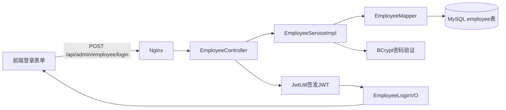

# 管理端登录链路学习笔记

> 整理日期：2026-10-12  
> 项目：智能园区餐饮 Agent 平台  
> 本阶段目标：让部署在 Nginx 中的前端能够调用 Spring Boot 后端，使用数据库中的管理员账号完成登录并获得 JWT。

## 1. 本阶段完成结果

目前已经打通以下链路：



实际测试已经返回：

```json
{
  "code": 1,
  "msg": "",
  "data": {
    "id": 1,
    "name": "管理员",
    "role": "admin",
    "token": "eyJ..."
  }
}
```

这说明以下环节均已正常工作：

- Spring Boot 监听 `127.0.0.1:8080`；
- MyBatis-Plus 可以查询 MySQL；
- 数据库中存在启用状态的管理员；
- BCrypt 可以验证密码；
- JJWT 0.13.0 可以签发 JWT；
- Controller 能按前端合同返回统一 JSON。

当前只完成了“登录和签发令牌”。JWT 拦截器、ThreadLocal 用户上下文和其他业务接口尚未实现。

## 2. 项目运行与单独运行 Java 类

项目中可以有多个 `main()` 方法，但运行其中一个不会自动运行其他入口。

### 2.1 运行整个后端

运行：

```java
com.sky.SkyApplication.main()
```

作用：

- 启动 Spring 容器；
- 创建 Controller、Service、Mapper、配置类等 Bean；
- 启动内嵌 Tomcat；
- 监听 `8080` 端口；
- 持续等待 HTTP 请求。

成功日志包含：

```text
Tomcat started on port 8080
Started SkyApplication
```

### 2.2 单独运行密码生成器

运行：

```java
com.sky.PasswordGenerator.main()
```

作用：只生成一次 BCrypt 密码哈希，打印完成后进程结束。

它位于：

```text
backend/sky-server/src/test/java/com/sky/PasswordGenerator.java
```

启动 `SkyApplication` 不会自动执行 `PasswordGenerator`，因为它们是两个独立的 Java 程序入口。

## 3. 环境连接验证

### 3.1 MySQL

Spring Boot 日志中出现以下内容，说明连接池已经取得真实数据库连接：

```text
HikariPool-1 - Added connection
HikariPool-1 - Start completed
```

数据库使用：

```text
campus_dining
```

### 3.2 Redis

Redis 通过 Docker 容器运行时，可以这样检查：

```powershell
docker exec campus-redis redis-cli ping
```

正常返回：

```text
PONG
```

本阶段的登录接口暂未使用 Redis，但后续缓存、Token 状态或业务数据可能使用。

## 4. 准备管理员账号

### 4.1 为什么不能保存明文密码

数据库不应保存：

```text
admin123
```

而应保存 BCrypt 生成的哈希：

```text
$2a$10$...
```

即使数据库泄露，也不能直接从哈希还原原始密码。

### 4.2 BCrypt 配置

依赖添加在 `sky-server/pom.xml`：

```xml
<dependency>
    <groupId>org.springframework.security</groupId>
    <artifactId>spring-security-crypto</artifactId>
</dependency>
```

配置类：

```java
package com.sky.config;

import org.springframework.context.annotation.Bean;
import org.springframework.context.annotation.Configuration;
import org.springframework.security.crypto.bcrypt.BCryptPasswordEncoder;
import org.springframework.security.crypto.password.PasswordEncoder;

@Configuration
public class PasswordConfiguration {

    @Bean
    public PasswordEncoder passwordEncoder() {
        return new BCryptPasswordEncoder();
    }
}
```

`@Bean` 让 Spring 管理唯一的 `PasswordEncoder` 对象，Service 可以通过构造方法注入它。

### 4.3 生成初始密码哈希

```java
package com.sky;

import org.springframework.security.crypto.bcrypt.BCryptPasswordEncoder;

public class PasswordGenerator {

    public static void main(String[] args) {
        BCryptPasswordEncoder encoder =
                new BCryptPasswordEncoder();

        String result = encoder.encode("admin123");
        System.out.println(result);
    }
}
```

BCrypt 每次 `encode()` 都会生成不同结果，因此不能重新编码后用字符串相等比较。

正确验证方式：

```java
passwordEncoder.matches(rawPassword, storedHash);
```

### 4.4 数据库记录

先检查账号：

```sql
SELECT id, name, username, phone, status
FROM employee
WHERE username = 'admin';
```

没有账号时插入：

```sql
INSERT INTO employee
    (name, username, password, phone, status)
VALUES
    ('管理员', 'admin', '这里填写完整BCrypt哈希', '13800000000', 1);
```

其中：

- 用户名：`admin`；
- 登录时输入的原始密码：`admin123`；
- 数据库存储：完整 BCrypt 哈希；
- `status = 1`：账号启用。

## 5. 三个 Maven 模块的职责

```text
backend
├─ sky-common   通用返回对象、通用异常等
├─ sky-pojo     Entity、DTO、VO
└─ sky-server   Controller、Service、Mapper、配置和启动类
```

本阶段新增内容：

```text
sky-common
└─ com.sky.exception.BusinessException

sky-pojo
├─ com.sky.entity.Employee
├─ com.sky.dto.EmployeeLoginDTO
└─ com.sky.vo.EmployeeLoginVO

sky-server
├─ com.sky.config.PasswordConfiguration
├─ com.sky.mapper.EmployeeMapper
├─ com.sky.service.EmployeeService
├─ com.sky.service.impl.EmployeeServiceImpl
├─ com.sky.properties.JwtProperties
├─ com.sky.util.JwtUtil
└─ com.sky.controller.admin.EmployeeController
```

## 6. Entity：数据库表在 Java 中的表示

文件：

```text
backend/sky-pojo/src/main/java/com/sky/entity/Employee.java
```

```java
package com.sky.entity;

import com.baomidou.mybatisplus.annotation.IdType;
import com.baomidou.mybatisplus.annotation.TableId;
import com.baomidou.mybatisplus.annotation.TableName;
import lombok.Data;

import java.time.LocalDateTime;

@Data
@TableName("employee")
public class Employee {

    @TableId(type = IdType.AUTO)
    private Long id;
    private String name;
    private String username;
    private String password;
    private String phone;
    private Integer status;
    private LocalDateTime createTime;
    private LocalDateTime updateTime;
    private Long createUser;
    private Long updateUser;
}
```

映射关系示例：

| Java 属性 | 数据库字段 |
| --- | --- |
| `createTime` | `create_time` |
| `updateTime` | `update_time` |
| `createUser` | `create_user` |
| `updateUser` | `update_user` |

`application-local.yml` 中的 `map-underscore-to-camel-case: true` 负责下划线字段与驼峰属性的自动映射。

## 7. Mapper：访问数据库

文件：

```text
backend/sky-server/src/main/java/com/sky/mapper/EmployeeMapper.java
```

```java
package com.sky.mapper;

import com.baomidou.mybatisplus.core.mapper.BaseMapper;
import com.sky.entity.Employee;
import org.apache.ibatis.annotations.Mapper;

@Mapper
public interface EmployeeMapper extends BaseMapper<Employee> {
}
```

虽然接口中没有手写方法，但 `BaseMapper<Employee>` 已提供基本的增删改查方法。MyBatis-Plus 会在程序启动时生成代理实现，不需要创建 `EmployeeMapperImpl`。

创建 Mapper 后，原来的启动警告：

```text
No MyBatis mapper was found in '[com.sky]' package
```

随之消失。

## 8. DTO：接收登录请求

文件：

```text
backend/sky-pojo/src/main/java/com/sky/dto/EmployeeLoginDTO.java
```

```java
package com.sky.dto;

import jakarta.validation.constraints.NotBlank;
import jakarta.validation.constraints.Size;
import lombok.Data;

@Data
public class EmployeeLoginDTO {

    @NotBlank(message = "用户名不能为空")
    @Size(max = 50, message = "用户名长度不能超过50个字符")
    private String username;

    @NotBlank(message = "密码不能为空")
    @Size(max = 100, message = "密码长度不能超过100个字符")
    private String password;
}
```

前端请求 JSON：

```json
{
  "username": "admin",
  "password": "admin123"
}
```

Spring Boot 3 使用 `jakarta.validation`，不是旧项目中的 `javax.validation`。

## 9. 业务异常和统一异常处理

### 9.1 业务异常

文件：

```text
backend/sky-common/src/main/java/com/sky/exception/BusinessException.java
```

```java
package com.sky.exception;

public class BusinessException extends RuntimeException {

    public BusinessException(String message) {
        super(message);
    }
}
```

业务错误可以这样抛出：

```java
throw new BusinessException("用户名或密码错误");
```

### 9.2 全局处理

在 `GlobalExceptionHandler` 中加入：

```java
@ExceptionHandler(BusinessException.class)
public Result<Void> business(BusinessException exception) {
    return Result.error(exception.getMessage());
}
```

业务失败返回：

```json
{
  "code": 0,
  "msg": "用户名或密码错误",
  "data": null
}
```

导入语句显示为灰色，通常表示“已经导入但暂未使用”，并不代表编译错误。添加异常处理方法后，该导入就会被使用。

## 10. Service：登录核心业务

### 10.1 接口

```java
package com.sky.service;

import com.sky.dto.EmployeeLoginDTO;
import com.sky.entity.Employee;

public interface EmployeeService {

    Employee login(EmployeeLoginDTO loginDTO);
}
```

接口定义能力，实现类负责具体逻辑。

### 10.2 实现类

```java
package com.sky.service.impl;

import com.baomidou.mybatisplus.core.conditions.query.LambdaQueryWrapper;
import com.sky.dto.EmployeeLoginDTO;
import com.sky.entity.Employee;
import com.sky.exception.BusinessException;
import com.sky.mapper.EmployeeMapper;
import com.sky.service.EmployeeService;
import org.springframework.security.crypto.password.PasswordEncoder;
import org.springframework.stereotype.Service;

@Service
public class EmployeeServiceImpl implements EmployeeService {

    private final EmployeeMapper employeeMapper;
    private final PasswordEncoder passwordEncoder;

    public EmployeeServiceImpl(
            EmployeeMapper employeeMapper,
            PasswordEncoder passwordEncoder) {
        this.employeeMapper = employeeMapper;
        this.passwordEncoder = passwordEncoder;
    }

    @Override
    public Employee login(EmployeeLoginDTO loginDTO) {
        Employee employee = employeeMapper.selectOne(
                new LambdaQueryWrapper<Employee>()
                        .eq(
                                Employee::getUsername,
                                loginDTO.getUsername().trim()
                        )
        );

        if (employee == null) {
            throw new BusinessException("用户名或密码错误");
        }

        boolean passwordCorrect = passwordEncoder.matches(
                loginDTO.getPassword(),
                employee.getPassword()
        );

        if (!passwordCorrect) {
            throw new BusinessException("用户名或密码错误");
        }

        if (!Integer.valueOf(1).equals(employee.getStatus())) {
            throw new BusinessException("账号已停用");
        }

        return employee;
    }
}
```

执行顺序：

1. 根据用户名查询数据库；
2. 判断账号是否存在；
3. 使用 BCrypt 验证密码；
4. 检查账号是否启用；
5. 返回已经通过验证的 `Employee`。

## 11. VO：只返回前端需要的数据

文件：

```text
backend/sky-pojo/src/main/java/com/sky/vo/EmployeeLoginVO.java
```

```java
package com.sky.vo;

import lombok.AllArgsConstructor;
import lombok.Builder;
import lombok.Data;
import lombok.NoArgsConstructor;

@Data
@Builder
@NoArgsConstructor
@AllArgsConstructor
public class EmployeeLoginVO {

    private Long id;
    private String name;
    private String role;
    private String token;
}
```

不能直接将 `Employee` 返回给前端，因为 `Employee` 中包含密码哈希。VO 只保留前端登录会话需要的字段。

## 12. JWT 配置

### 12.1 YAML 配置

在 `application.yml` 中加入：

```yaml
sky:
  jwt:
    secret-key: ${JWT_SECRET_KEY:本地开发用的至少32字节密钥}
    ttl: ${JWT_TTL:2h}
```

正式部署时应通过 `JWT_SECRET_KEY` 环境变量提供随机密钥，不应使用本地默认值。

### 12.2 配置属性类

```java
package com.sky.properties;

import lombok.Data;
import org.springframework.boot.context.properties.ConfigurationProperties;
import org.springframework.stereotype.Component;

import java.time.Duration;

@Data
@Component
@ConfigurationProperties(prefix = "sky.jwt")
public class JwtProperties {

    private String secretKey;
    private Duration ttl = Duration.ofHours(2);
}
```

Spring 自动映射：

```text
sky.jwt.secret-key → secretKey
sky.jwt.ttl        → ttl
```

## 13. JwtUtil：签发和解析令牌

```java
package com.sky.util;

import com.sky.properties.JwtProperties;
import io.jsonwebtoken.Claims;
import io.jsonwebtoken.JwtParser;
import io.jsonwebtoken.Jwts;
import io.jsonwebtoken.security.Keys;
import org.springframework.stereotype.Component;

import javax.crypto.SecretKey;
import java.nio.charset.StandardCharsets;
import java.time.Duration;
import java.time.Instant;
import java.util.Date;

@Component
public class JwtUtil {

    private static final String ISSUER = "campus-dining";

    private final SecretKey signingKey;
    private final Duration ttl;
    private final JwtParser jwtParser;

    public JwtUtil(JwtProperties jwtProperties) {
        this.signingKey = Keys.hmacShaKeyFor(
                jwtProperties.getSecretKey()
                        .getBytes(StandardCharsets.UTF_8)
        );

        this.ttl = jwtProperties.getTtl();

        this.jwtParser = Jwts.parser()
                .requireIssuer(ISSUER)
                .verifyWith(signingKey)
                .build();
    }

    public String createToken(Long userId, String role) {
        Instant now = Instant.now();

        return Jwts.builder()
                .issuer(ISSUER)
                .subject(userId.toString())
                .claim("role", role)
                .issuedAt(Date.from(now))
                .expiration(Date.from(now.plus(ttl)))
                .signWith(signingKey)
                .compact();
    }

    public Claims parseToken(String token) {
        return jwtParser
                .parseSignedClaims(token)
                .getPayload();
    }
}
```

JWT中的内容包括：

| 字段 | 含义 |
| --- | --- |
| `iss` | 签发系统 `campus-dining` |
| `sub` | 当前登录账号 ID |
| `role` | 身份角色，例如 `admin` |
| `iat` | 签发时间 |
| `exp` | 过期时间 |

JWT有签名但负载没有加密，因此不能放入密码、数据库凭证等敏感信息。

本项目当前使用 `.signWith(signingKey)`，JJWT 会依据密钥长度选择合适的 HMAC 算法。测试令牌使用 `HS384` 属于正常现象。

## 14. Controller：对外提供登录接口

```java
package com.sky.controller.admin;

import com.sky.dto.EmployeeLoginDTO;
import com.sky.entity.Employee;
import com.sky.result.Result;
import com.sky.service.EmployeeService;
import com.sky.util.JwtUtil;
import com.sky.vo.EmployeeLoginVO;
import jakarta.validation.Valid;
import org.springframework.web.bind.annotation.PostMapping;
import org.springframework.web.bind.annotation.RequestBody;
import org.springframework.web.bind.annotation.RequestMapping;
import org.springframework.web.bind.annotation.RestController;

@RestController
@RequestMapping("/api/admin/employee")
public class EmployeeController {

    private final EmployeeService employeeService;
    private final JwtUtil jwtUtil;

    public EmployeeController(
            EmployeeService employeeService,
            JwtUtil jwtUtil) {
        this.employeeService = employeeService;
        this.jwtUtil = jwtUtil;
    }

    @PostMapping("/login")
    public Result<EmployeeLoginVO> login(
            @Valid @RequestBody EmployeeLoginDTO loginDTO) {

        Employee employee = employeeService.login(loginDTO);

        String token = jwtUtil.createToken(
                employee.getId(),
                "admin"
        );

        EmployeeLoginVO loginVO = EmployeeLoginVO.builder()
                .id(employee.getId())
                .name(employee.getName())
                .role("admin")
                .token(token)
                .build();

        return Result.success(loginVO);
    }
}
```

最终接口：

```text
POST /api/admin/employee/login
```

`@Valid` 会触发 DTO 字段校验，`@RequestBody` 会把请求 JSON 转换为 Java 对象。

## 15. PowerShell 验证

### 15.1 直接请求 Spring Boot

```powershell
$body = @{
    username = "admin"
    password = "admin123"
} | ConvertTo-Json

$response = Invoke-RestMethod `
    -Uri "http://127.0.0.1:8080/api/admin/employee/login" `
    -Method Post `
    -ContentType "application/json" `
    -Body $body

$response | ConvertTo-Json -Depth 5
```

### 15.2 通过 Nginx 请求

```powershell
$response = Invoke-RestMethod `
    -Uri "http://127.0.0.1/api/admin/employee/login" `
    -Method Post `
    -ContentType "application/json" `
    -Body $body
```

第一个请求验证后端本身，第二个请求验证 Nginx 反向代理。

## 16. 地址和端口的区别

| 地址 | 用途 |
| --- | --- |
| `http://127.0.0.1/` | Nginx托管的前端页面 |
| `http://127.0.0.1:8080/api/health` | Spring Boot健康检查 |
| `POST http://127.0.0.1:8080/api/admin/employee/login` | 直接访问后端登录接口 |
| `POST http://127.0.0.1/api/admin/employee/login` | 经过Nginx代理访问登录接口 |

访问：

```text
http://127.0.0.1:8080/
```

不会显示前端页面，因为 `8080` 是后端端口，而且后端没有定义根路径 `/`。

浏览器地址栏只能方便地发送 GET 请求，而登录接口要求 POST，因此不能直接在地址栏打开登录接口进行测试。

项目配置绑定：

```yaml
server:
  address: 127.0.0.1
```

部分 Windows 环境会把 `localhost` 优先解析为 IPv6 的 `::1`，所以本地测试优先使用 `127.0.0.1`。

## 17. 常见现象与判断方法

### 17.1 `Found 0 Redis repository interfaces`

这只是说明项目没有使用 Spring Data Repository 风格的 Redis 接口，不代表 Redis 连接失败。

### 17.2 管理员中文名在旧版 PowerShell 中乱码

如果 PowerShell 显示类似：

```text
管ç...
```

通常是 Windows PowerShell 5.1 对 UTF-8 JSON 的解码问题。数据库记录和浏览器端通常仍然正常，不要因此修改数据库中的中文。

### 17.3 接口返回 Token，但其他页面报接口未实现

这是当前阶段的正常结果。登录完成后，前端还会请求店铺、菜品、套餐或统计接口，而这些接口尚未实现。

### 17.4 JWT为什么不能等同于完整鉴权

当前后端只会签发 JWT。其他接口还没有拦截并验证请求头中的：

```text
token: <JWT>
```

因此目前属于“能登录并取得令牌”，还不是“所有接口已经受身份和权限保护”。

## 18. 下一阶段学习顺序

建议继续按照以下顺序实现：

1. 创建管理员 JWT 拦截器；
2. 从请求头 `token` 读取 JWT；
3. 验证签名、签发者和过期时间；
4. 从 `sub` 取出管理员 ID；
5. 使用 ThreadLocal 保存当前用户上下文；
6. 请求结束后清理 ThreadLocal；
7. 在 `WebMvcConfiguration` 注册拦截器，并排除登录接口；
8. 区分 HTTP 401（未登录或令牌失效）与 403（身份无权限）；
9. 编写一个需要登录的简单接口验证鉴权链路；
10. 再实现员工端登录和后续业务模块。

完成这些步骤后，登录链路才会从“签发令牌”升级为“完整身份认证与请求上下文透传”。
